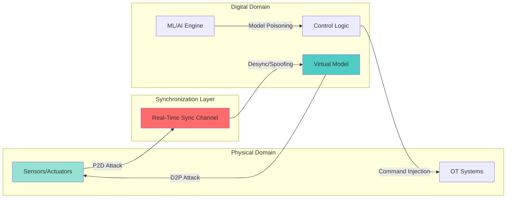
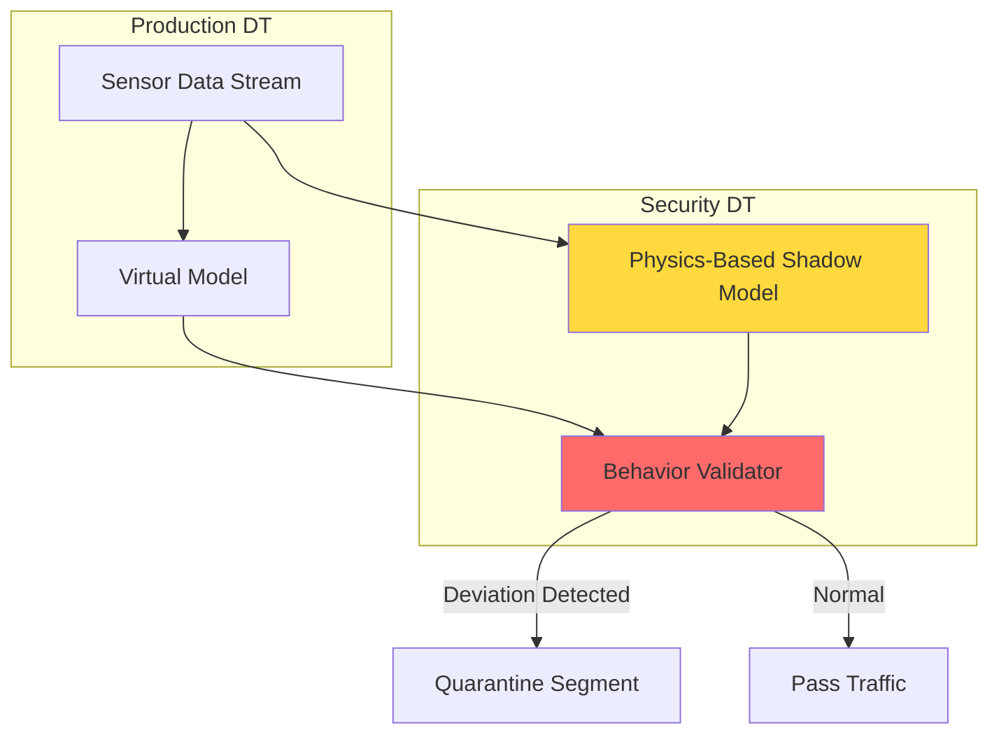

# Digital Twin Cybersecurity Research


> **A comprehensive analysis of cybersecurity threats, vulnerabilities, and defense mechanisms in Digital Twin ecosystems for Industry 4.0.**

Digital Twins (DTs) are real-time, bi-directional virtual replicas of physical systems enabling predictive maintenance and autonomous decision-making. This research examines the unique security challenges that arise from their continuous synchronization with physical assets—challenges that traditional IT/OT security models cannot address.

---

## Overview

**Research Focus:**
- Structural weaknesses in Digital Twin architectures
- Attack patterns targeting cyber-physical synchronization
- Emerging defense mechanisms (Blockchain, Federated Learning, Zero Trust)

**Key Insight:** Unlike traditional IT systems where attackers target data, Digital Twin attacks can directly impact physical systems—industrial equipment, vehicles, medical devices, and critical infrastructure.

[📥 Download Full Paper (PDF)](./Digital_Twin_Security_Review.pdf)

---

## Threat Taxonomy

We identify a dual-path attack surface where adversaries can compromise either the physical or digital domain:



### Attack Vectors

**Physical-to-Digital (P2D) Attacks:**

| Attack Type | Mechanism | Impact |
|------------|-----------|--------|
| **Sensor Spoofing** | Injecting false signals into temperature, pressure, or motion sensors | DT receives incorrect state information, leading to wrong predictions |
| **Desynchronization** | Deliberately delaying or interfering with network packets | Creates temporal drift between physical and digital states |
| **Data Poisoning** | Corrupting training data for ML-based predictive models | Model learns to ignore critical warnings (e.g., overheating) |

**Digital-to-Physical (D2P) Attacks:**

| Attack Type | Mechanism | Impact |
|------------|-----------|--------|
| **Command Injection** | Hijacked DT sends unauthorized control signals to actuators | Forces unsafe physical operations (e.g., overheating turbines) |
| **Model Manipulation** | Altering the virtual model's decision-making logic | Autonomous systems make dangerous choices |

---

## Defense Architecture

Our analysis identifies three critical countermeasure categories:

### 1. Blockchain-Based Data Integrity

**Implementation:**
- Immutable audit trails using hash-linked data chains
- Smart contract-based access control (RBAC without centralized administrators)
- Cryptographic verification of data provenance

**Trade-offs:**
- ✅ Tamper-proof historical logs
- ✅ Decentralized trust model
- ⚠️ High computational overhead for real-time systems

### 2. Federated Learning for Privacy-Preserving Collaboration

**Implementation:**
- Collaborative AI training across multiple DTs without raw data sharing
- Homomorphic Encryption for secure model aggregation
- Edge-based local training with centralized model updates

**Trade-offs:**
- ✅ Solves "data island" problem
- ✅ Preserves intellectual property
- ⚠️ Vulnerable to gradient-based attacks

### 3. Zero Trust Architecture (ZTA)

**Implementation:**
- Micro-segmentation treating all traffic as potentially hostile
- Security Digital Twin for parallel physics-based validation
- Real-time anomaly isolation

**Architecture:**



**Trade-offs:**
- ✅ Defense-in-depth
- ✅ Real-time cross-validation
- ⚠️ Requires duplicate computational resources

---

## Key Findings

1. **Traditional perimeter security (firewalls, VLANs) is insufficient** for DT environments where malicious behavior can be embedded in trusted internal traffic.

2. **The Asset Administration Shell (AAS)** standard improves interoperability but has critical weaknesses:
   - Weak access control granularity
   - Metadata tampering vulnerabilities
   - Lack of cryptographic binding between physical and digital objects

3. **Future-proof Digital Twins require:**
   - Dynamic, data-centric integrity validation
   - Continuous model behavior verification
   - Cryptographically verifiable provenance

---

## Research Methodology

- **28 peer-reviewed sources** (2018-2025)
- **Domains analyzed:** Manufacturing, Automotive, Healthcare, Smart Cities
- **Frameworks studied:** Blockchain, Federated Learning, Zero Trust, Asset Administration Shell

---

## Industry Applications

This research directly applies to:

| Domain | Use Case | Security Challenge |
|--------|----------|-------------------|
| **Manufacturing** | Predictive maintenance | Model poisoning in ML predictive systems |
| **Automotive** | Autonomous vehicle twins | CAN-Bus spoofing, desynchronization |
| **Healthcare** | Patient digital twins | Privacy-preserving biometrics, re-identification |
| **Smart Cities** | Infrastructure control | Cascading failures in water/energy systems |
| **Research Facilities** | CERN LHC, WLCG | OT/IT convergence in distributed computing |

---

## Authors

**Muhammad Daniyal, Mahad Aqeel, Muhammad Afeef, Muhammad Ismail**  
Faculty of Computer Science  
Ghulam Ishaq Khan Institute (GIKI), Pakistan

---

## Citation

```bibtex
@inproceedings{daniyal2024digital,
  title={Cybersecurity in Digital Twins: A Review of Threats, Challenges, and Emerging Defenses},
  author={Daniyal, Muhammad and Aqeel, Mahad and Afeef, Muhammad and Ismail, Muhammad},
  year={2024},
  institution={Ghulam Ishaq Khan Institute}
}
```

---

## Full Paper

The complete IEEE-formatted paper with detailed technical analysis and 28 references is available in this repository.

[📥 Download Full Paper (PDF)](./Digital_Twin_Security_Review.pdf)
